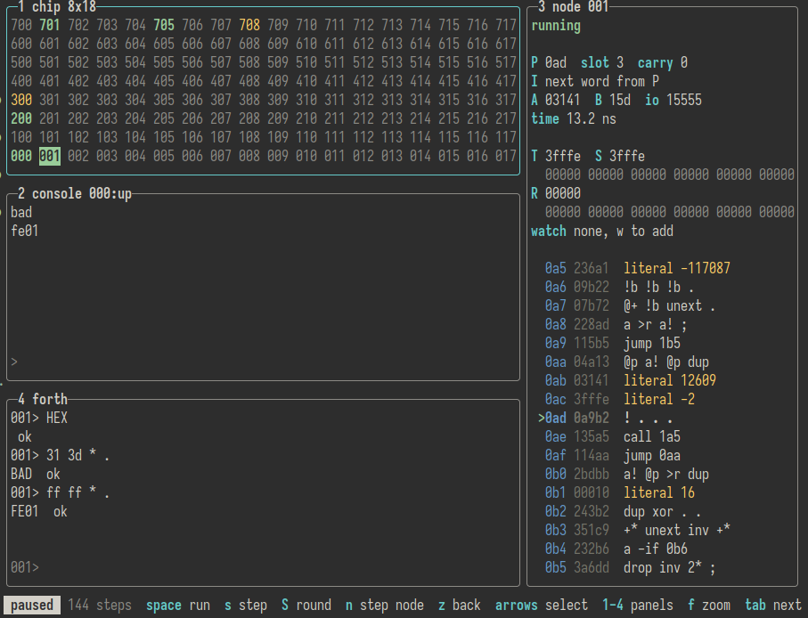
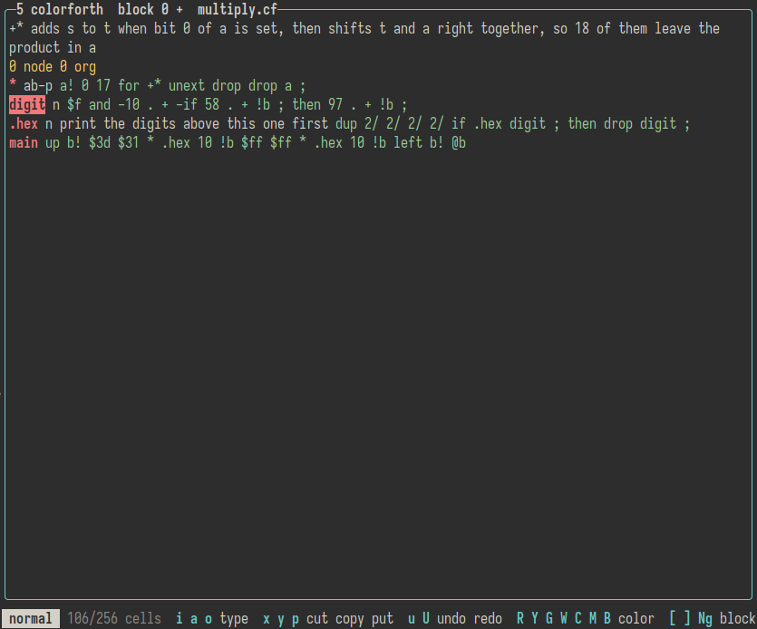

# gasim

A cross-platform simulator for the [GreenArrays,
Inc.](https://www.greenarraychips.com) [GA144 multi-computer
chip](https://www.greenarraychips.com/home/documents/index.php#GA144).



## Running

Download a pre-built binary for your operating system on the [GitHub
Releases](https://github.com/coat/gasim/releases) page, and see the Usage
section below.

Try out the [web based version](https://coat.github.io/gasim/).

If you have Nix installed: `nix run github:coat/gasim`, or `nix run
github:coat/gasim#gui` for the GUI.

`gasim-gui` is a desktop GUI, like the web version, in each release beside
`gasim`. On Linux it needs glibc, and X11 or Wayland.

## Usage

```bash
gasim examples/hello.ga
```

This assembles the program onto a simulated 8x18 array of F18A nodes, like the
GA144. Nodes without a program wait for code on all of their ports. You can
also just launch `gasim` without a program, if you want to load code from the
arrayForth panel. Hit `q` to quit.

By default a console is attached to the `up` port of node 000. With `run` (or
when stdin or stdout is not a terminal) gasim runs the program until every node
is waiting on something that cannot happen, except with the console on stdin and stdout
instead:

```
$ gasim run examples/hello.ga
Hello, world!
$ echo "hello" | gasim examples/echo.ga
hello
```

Programs can span several nodes with the `node` directive. In
`examples/upcase.ga`, node 000 passes input to its neighbour, node 001,
which converts it to upper case:

```bash
echo "hello" | gasim examples/upcase.ga
```

### TUI

This is a work in progress, but basically everything you need is on
one page in panels that you can resize, maximize and hide. Tab and
Shift+Tab to move around. That gets tricky when using the aforth or
console panels which have an input prompt, so you can use
alt/ctrl+1-5 to jump to a different panel. There's also mouse
support.

The status bar at the bottom should show relevant keybindings. Hit ?
or F1 to view keybindings.

For more info, check out the [TUI docs](docs/tui.md).

### colorForth



There's a built-in colorForth editor inspired by AshleyF's
[Color](https://github.com/AshleyF/Color) editor. Just open an existing .cf
file to view the editor (`gasim examples/hello.cf`). To output colorForth .cf
binary files as text, try `gasim blocks examples/hello.cf`. 

More info - like key bindings - in the [colorForth
documentation](docs/colorForth.md).

### arrayForth

The `aforth` panel in the TUI is essentially an arrayForth outer interpreter.

Files ending in `.af` are read as arrayForth 3 source, the F18 assembler
syntax of GreenArrays' current tools.

```
$ gasim run examples/hello.af
Hello, world!
$ echo "hello" | gasim examples/echo.af
hello
```

Check out the [arrayForth documentation](docs/arrayForth.md) for a
more info.


### Options

- `--layout <rows>x<columns>`: size of the array of nodes, up to 100x100
  (default `8x18`)
- `--console <node>:<port>`: where the console is attached, on a port facing
  off the edge of the array (default `000:up`)
- `--rom <path>`: ROM to load into the nodes: a dump of it, or arrayForth
  3's disk (`sF/pFDISK.blk`) or the directory it is installed in, to
  assemble it from (see [ROM](#rom))
- `--uart <node>[:<baud>]`: with `run`, put stdin and stdout on a UART on
  the node's pins 17 and 1 instead of the console. This is how a USB serial
  port is wired to node 708 on GreenArrays' evaluation boards, with both
  lines inverted (default 921600 baud). Bytes from the host boot node 708
  from ROM, so `gasim run --uart 708` without a program boots whatever stdin
  sends it, such as a stream from ga-tools.
- `--boot`: load programs with a boot stream through the SERDES port of node
  001, as one GA144 boots another, instead of writing them straight into RAM.
  With `--uart 708`, the stream goes through the UART to node 708's ROM
  instead, before stdin. This needs ROM.

  ```
  $ gasim run --uart 708 examples/uart.ga
  Hello, world!
  $ gasim run --uart 708 --boot examples/uart.ga
  Hello, world!
  ```

- `--break <node>:<address>`: stop when the node is about to fetch the word at
  the address, given in hex, and print its stacks and registers. Literals
  are never fetched as instructions, so a breakpoint on one never stops. Can
  be given more than once.
- `--watch <node>:<port>[:read|:write]`: stop when the node reads from or
  writes to the port, or only one of those, and print the value. Reads include
  instruction words the node fetches from the port, such as a boot stream. Can
  be given more than once.
- `--trace`: with `run`, write a line to stderr for each word a node executes:
  the node, the word's address, the raw word, its opcodes, and T, S and R
  after it.

```
$ gasim run --trace --break 000:004 examples/hello.ga
000 000 04b12 @p b! @p .  T 00007 S 00000 R 00000
...
000 003 2bcba a! @+ >r .  T 00000 S 00000 R 0000d
info: node 000 reached 004
info: P 004  T 00000  S 00000  R 0000d  A 00008  B 145
```

- `--why`: with `run`, once every node is waiting, say what each one is
  waiting on. Nodes waiting on several ports, as they do after reset, are
  only counted.

```
$ echo hi | gasim run --why examples/upcase.ga
HI
info: node 000 waiting to read up
info: node 001 waiting to read right
info: 142 nodes waiting on several ports, as after reset
```

- `--listing`: instead of running, write each node's words: the address, the
  raw word, its opcodes or literal value, and the source line it came from.

```
$ gasim --listing examples/hello.ga
node 000
000 04b12  @p b! @p .                 7      up b!                  \ B addresses the console
001 00145  literal up
002 00007  literal 7                  8      'message a!            \ A walks through the message
...
```

See [`src/assembler.zig`](src/assembler.zig) for the assembler syntax.

### ROM

The GA144's ROM is copyright GreenArrays, Inc., and not part of gasim. Its
source is in `sF/pFDISK.blk` of GreenArrays'
[arrayForth 3](https://www.greenarraychips.com/home/support/download-03d.php),
which gasim assembles it from, as arrayForth 3 does. Without `--rom`, gasim
looks for arrayForth 3 where its installer puts it, in `C:\GreenArrays`, or
on Linux and macOS in Wine's C: drive, in `$WINEPREFIX` or `~/.wine`, such
as `~/.wine/drive_c/GreenArrays/EVB002`.

gasim assembles the ROM once, and saves it as `gasim/ga144.txt` in
`$XDG_DATA_HOME`, `~/.local/share` by default, or `%LOCALAPPDATA%` on
Windows, which it loads after that without needing arrayForth 3. `--rom` can
also give a dump of the ROM in that format, which
[`rom/README.md`](rom/README.md) describes. Deleting the saved ROM has gasim
assemble it again.

With ROM, each node gets the ROM of the GA144 node with the same number, and
the boot nodes start in their boot code after reset, as on the real chip.
Programs can also call ROM words such as `*.17` and `warm` by name.

Without ROM, nodes without a program wait for code on their ports, and
programs cannot call ROM words.

## Building

To build `gasim`, [zig 0.17.0](https://ziglang.org/download/) is required.

```bash
zig build -Doptimize=ReleaseFast
```

`gasim` will be available in `./zig-out/bin/gasim`.

The GUI is built only with `-Dgui`, which fetches
[dvui](https://github.com/david-vanderson/dvui) and SDL3: `zig build -Dgui`
builds `./zig-out/bin/gasim-gui` beside `gasim`, `zig build -Dgui run-gui`
runs it, and `zig build -Dgui test-gui` runs its tests in a hidden window. On
Linux it links the system's SDL3 (in the Nix dev shell); `-fno-sys=sdl3`
builds SDL3 from source instead, as the releases do.

`zig build web` builds the web version into `./zig-out/web`, and `zig build
test-web` runs its tests, which need [Deno](https://deno.com/) (in the Nix dev
shell).

`zig build test -Dfuzz --fuzz` fuzzes the assemblers and colorForth's blocks
and images, with a web UI showing coverage, or `--fuzz=1M` for a million
inputs each. `-Dfuzz` builds the tests with LLVM, which the fuzzer needs for
its coverage. The examples seed the fuzzer, as does arrayForth 3's disk if it
is in `rom/` (see [rom/README.md](rom/README.md)).

## Prior Art

- GreenArrays' own SOFTSIM available in their free [arrayForth
distribution](https://www.greenarraychips.com/home/support/download-03d.php).
Works well under wine.
- [AshleyF/Color](https://github.com/AshleyF/Color) - A colorForth editor,
assembler and F18 simulator written in F#. gasim's colorForth editor is heavily
based on the vim-like editor.
- [mschuldt/ga144-sim](https://github.com/mschuldt/ga144-sim) - GA144 simulator
from an [alternative toolchain](https://github.com/mschuldt/ga-tools).

## References

- Incredibly informative [blog
series](https://github.com/AshleyF/Color/blob/master/Docs/chuck_moores_creations.md)
by [AshleyF](https://github.com/AshleyF) that introduces the F18 architecture
and instruction set.
- GreenArrays' own concise, but very informative
[documentation](https://www.greenarraychips.com/home/documents/index.php) on
the GA144 chip and F18 architecture.
- [colorForth instruction
set](https://mschuldt.github.io/www.colorforth.com/inst.htm)
