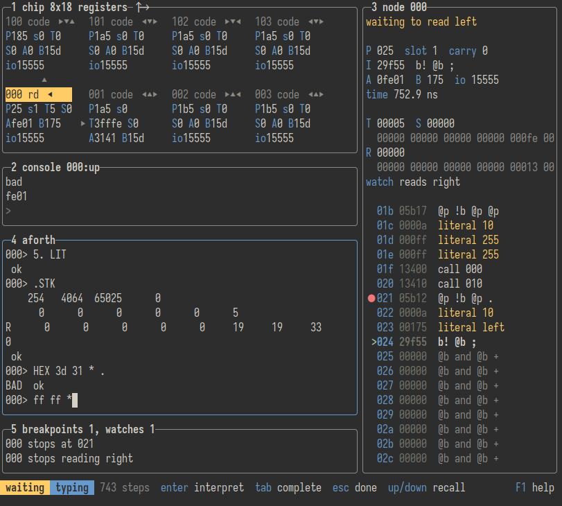
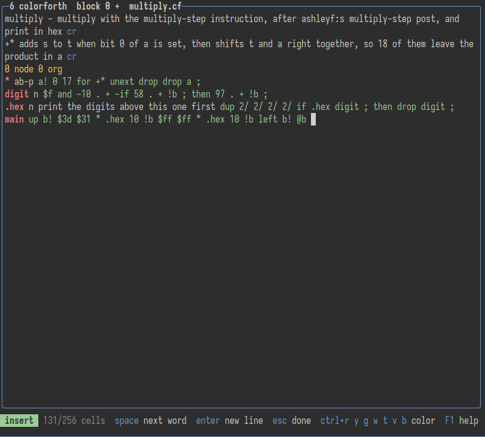

# gasim

A cross-platform simulator for the [GreenArrays,
Inc.](https://www.greenarraychips.com) [GA144 multi-computer
chip](https://www.greenarraychips.com/home/documents/index.php#GA144).



## Running

Download a pre-built binary for your operating system on the [GitHub
Releases](https://github.com/coat/gasim/releases) page, and see the Usage
section below.

Try out the [web based version](https://coat.github.io/gasim/).

If you have Nix installed: `nix run github:coat/gasim`, or `nix run
github:coat/gasim#gui` for the GUI.

`gasim-gui` is a desktop GUI, like the web version, in each release beside
`gasim`. On Linux it needs glibc, and X11 or Wayland.

The examples come in `examples` beside the binaries in a release, and in
`share/gasim/examples` in the Nix package and `zig build`'s `zig-out`. The
GUI's Examples menu reads them from there, or from `gasim/examples` under
`XDG_DATA_HOME` (`~/.local/share`, or `LOCALAPPDATA` on Windows) or
`XDG_DATA_DIRS`, and is left out if they are nowhere.

### Fonts and colors

`gasim-gui` reads its fonts and colors from `gasim/gui.json` under
`XDG_CONFIG_HOME` (`~/.config`). Fonts are files, since the GUI draws only the
TrueType and OpenType files it's given; a face left out is made from the
regular one. The size is in points. The colors are a
[base16](https://github.com/tinted-theming/home) scheme, shown by the Auto
theme; Light and Dark keep their own colors, with the fonts chosen.

```json
{
  "fonts": {
    "sans": { "regular": "/path/to/Inter-Regular.ttf", "bold": "/path/to/Inter-Bold.ttf" },
    "mono": { "regular": "/path/to/JetBrainsMono-Regular.otf" },
    "size": 11
  },
  "colors": { "base00": "#1d2021", "base01": "#3c3836", "...": "...", "base0F": "#d65d0e" }
}
```

With Home Manager, the flake's module writes it, from
[Stylix](https://github.com/nix-community/stylix) when Stylix is on:

```nix
{
  imports = [gasim.homeModules.default];
  programs.gasim.enable = true;
  # without Stylix, or to override it
  programs.gasim.fonts.mono = { package = pkgs.jetbrains-mono; name = "JetBrains Mono"; };
}
```

## Usage

```bash
gasim examples/hello.ga
```

This assembles the program onto a simulated 8x18 array of F18A nodes, like the
GA144. Nodes without a program wait for code on all of their ports. You can
also just launch `gasim` without a program, if you want to load code from the
arrayForth panel. Hit `q` to quit.

By default a console is attached to the `up` port of node 000. With `run` (or
when stdin or stdout is not a terminal) gasim runs the program until every node
is waiting on something that cannot happen, except with the console on stdin and stdout
instead:

```
$ gasim run examples/hello.ga
Hello, world!
$ echo "hello" | gasim examples/echo.ga
hello
```

Programs can span several nodes with the `node` directive. In
`examples/upcase.ga`, node 000 passes input to its neighbour, node 001,
which converts it to upper case:

```bash
echo "hello" | gasim examples/upcase.ga
```

### TUI

This is a work in progress, but basically everything you need is on
one page in panels that you can resize, maximize and hide. Tab and
Shift+Tab to move around. That gets tricky when using the aforth or
console panels which have an input prompt, so you can use
alt/ctrl+1-5 to jump to a different panel. There's also mouse
support.

The status bar at the bottom should show relevant keybindings. Hit ?
or F1 to view keybindings.

For more info, check out the [TUI docs](docs/tui.md).

### colorForth



There's a built-in colorForth editor inspired by AshleyF's
[Color](https://github.com/AshleyF/Color) editor. Open a .cf file to start in
the editor (`gasim examples/hello.cf`), or hit alt+6 in the TUI to edit a new
file of blocks, and `:w`, `:e` and `:new` to save, open and start files. To
output colorForth .cf binary files as text, try `gasim blocks
examples/hello.cf`. 

More info - like key bindings - in the [colorForth
documentation](docs/colorForth.md).

### arrayForth

The `aforth` panel in the TUI is essentially an arrayForth outer interpreter.

Files ending in `.af` are read as arrayForth 3 source, the F18 assembler
syntax of GreenArrays' current tools.

```
$ gasim run examples/hello.af
Hello, world!
$ echo "hello" | gasim examples/echo.af
hello
```

Check out the [arrayForth documentation](docs/arrayForth.md) for a
more info.


### Options

- `--board <file>`: with `run`, the board around the chips, described in a
  board file (see [Board files](#board-files)), or `evb002` for
  GreenArrays' EVB002, with stdin and stdout on one of its serial ports
- `--usb <port>`: the board's serial port on stdin and stdout (default its
  first, such as `A`, unless `--pty` is given; `C` is the EVB002's target
  chip's)
- `--pty <port>[=<link>]`: put one of the board's serial ports on a
  pseudo-terminal, as a USB serial port's device, such as for arrayForth 3
  under Wine, saying its path, and making a symbolic link to it at `<link>`
  if given. Can be given more than once (see [Serial ports on
  ptys](#serial-ports-on-ptys)).
- `--jumper <name>=on|off`: set one of the board's jumpers otherwise than
  as it is shipped, such as `J26=off`. Can be given more than once.
- `--flash <file>`: with `run`, the contents of the board's SPI flash, up
  to 16 MB, erased past the end. The EVB002's host 705 boots from it with
  `--jumper J26=off` (NO BOOT), and the ROM.
- `--chip <file>`: the chip, described in a chip file (see [Chip
  files](#chip-files); default the GA144)
- `--layout <rows>x<columns>`: a chip of that size, up to 100x100, of basic
  nodes with no pins, instead of the GA144
- `--console <node>:<port>`: where the console is attached, on a port facing
  off the edge of the array (default `000:up`)
- `--rom <path>`: ROM to load into the nodes: a dump of it, or arrayForth
  3's disk (`sF/pFDISK.blk`) or the directory it is installed in, to
  assemble it from (see [ROM](#rom))
- `--uart <node>[:<baud>]`: with `run`, put stdin and stdout on a UART on
  the node's pins 17 and 1 instead of the console. This is how a USB serial
  port is wired to node 708 on GreenArrays' evaluation boards, with both
  lines inverted (default 921600 baud). Bytes from the host boot node 708
  from ROM, so `gasim run --uart 708` without a program boots whatever stdin
  sends it, such as a stream from ga-tools.
- `--boot`: load programs with a boot stream through the SERDES port of node
  001, as one GA144 boots another, instead of writing them straight into RAM.
  With `--uart 708`, the stream goes through the UART to node 708's ROM
  instead, before stdin. This needs ROM. An arrayForth 3 source's `STREAM[
  ... ]STREAM` is laid out as arrayForth 3's STREAMER does: from 708
  through the UART, from 705 packed into the board's SPI flash, for
  705's ROM to read (`--board evb002 --jumper J26=off --boot`), or from
  300, clocked into its pins 17 and 1 as the disk's sync master (bin 1901)
  clocks a word out, with `run` and no `--board`. A stream from 207 is
  pF/144's snorkel's to send, so `--boot` refuses it; without `--boot`, a
  stream of one frame sets its nodes up as any descriptors do. A path can
  go on from a node to the same node of the other chip, as the EVB002's
  sync bridge between its 300s carries what host 400 writes to its up port
  to target 400 (block 1668). The stream doesn't build the bridge: a frame
  before, as block 1670's does, has to.

  ```
  $ gasim run --uart 708 examples/uart.ga
  Hello, world!
  $ gasim run --uart 708 --boot examples/uart.ga
  Hello, world!
  ```

- `--break <node>:<address>`: stop when the node is about to fetch the word at
  the address, given in hex, and print its stacks and registers. Literals
  are never fetched as instructions, so a breakpoint on one never stops. Can
  be given more than once.
- `--watch <node>:<port>[:read|:write]`: stop when the node reads from or
  writes to the port, or only one of those, and print the value. Reads include
  instruction words the node fetches from the port, such as a boot stream. Can
  be given more than once.
- `--trace`: with `run`, write a line to stderr for each word a node executes:
  the node, the word's address, the raw word, its opcodes, and T, S and R
  after it.

```
$ gasim run --trace --break 000:004 examples/hello.ga
000 000 04b12 @p b! @p .  T 00007 S 00000 R 00000
...
000 003 2bcba a! @+ >r .  T 00000 S 00000 R 0000d
info: node 000 reached 004
info: P 004  T 00000  S 00000  R 0000d  A 00008  B 145
```

- `--why`: with `run`, once every node is waiting, say what each one is
  waiting on. Nodes waiting on several ports, as they do after reset, are
  only counted.

```
$ echo hi | gasim run --why examples/upcase.ga
HI
info: node 000 waiting to read up
info: node 001 waiting to read right
info: 142 nodes waiting on several ports, as after reset
```

- `--stats`: with `run`, once it stops, say how many steps the nodes took
  (a step runs an instruction word, its `unext` loops included, or tries to
  while it waits on a port), how many a second of the run, waiting for
  input included, and how much of the chip's time passed: the most any
  node's clock reached.

```
$ gasim run --stats tools/bench/ring.ga > /dev/null
info: 7300937 steps in 0.670 s, 10.9M steps/s, and 44.882 ms of the chip's time
```

- `--listing`: instead of running, write each node's words: the address, the
  raw word, its opcodes or literal value, and the source line it came from.

```
$ gasim --listing examples/hello.ga
node 000
000 04b12  @p b! @p .                 7      up b!                  \ B addresses the console
001 00145  literal up
002 00007  literal 7                  8      'message a!            \ A walks through the message
...
```

See [`src/assembler.zig`](src/assembler.zig) for the assembler syntax.

### Chip files

A chip file says what a chip is made of, in [ZON](https://ziglang.org/documentation/master/#toc-ZON):
the size of its array, and each node that is not a basic node with no
pins, with its ROM type, GPIO pins, and the word of its ROM it starts at
after reset (`.cold` or `.warm`). SERDES boot nodes have a data register.
The GA144's is
[`src/chips/ga144.zon`](src/chips/ga144.zon), built into gasim.
[`examples/chips/2x2.zon`](examples/chips/2x2.zon) is a chip of four nodes,
one of them wired as the GA144's 708 is:

```
$ gasim run --chip examples/chips/2x2.zon --uart 100 examples/chips/hello-2x2.ga
Hello, world!
```

A node gets the ROM of the GA144 node with its number if that node has the
same ROM type, and else of a GA144 node that does (basic nodes 404's; the
special nodes, whose ROMs differ, only their own). A ROM names ports, and
its `warm` jumps to its GA144 node's neighbours, so a node with a borrowed
ROM should sit as that node does: in a column and row of the same parity,
and off the same edges. Pin 17 wakes a node through up on the top and
bottom rows and left on the others, where that port faces off the array.

Programs in `.ga` are assembled for the chip's ROMs. arrayForth 3 and
colorForth programs are assembled for the GA144's, and gasim refuses one
for a node whose ROM type differs from the GA144's node of its number.

### Board files

A board file says what a board puts around its chips, in ZON: their chip
file (`ga144` for the GA144, or a path relative to the board file), how
many chips there are of it, serial ports wired to the chips' pins, pull
resistors, wires between pins, SERDES links between nodes, pins wired to
chips' RESET- pins, and named jumpers that connect some of them, on or off
as the board is shipped. The nodes of chips after the first are numbered
with the chip before them, such as `1.708`, in a board file as `.chip = 1,
.node = 708`, and in programs (`node 1.708`) and options (`--break
1.708:004`) as `1.708`. The nodes of all the chips run as one, the
furthest behind in time first.

The EVB002's, [`src/boards/evb002.zon`](src/boards/evb002.zon), is built
in as `evb002`, from its data book (DB014) and the jumper settings it ships
with (AN021):

- the host chip, with USB ports A (708's pins 17 and 1) and B (200.17 in,
  100.17 out), J26 (NO BOOT) holding 705.17 high, and pull-ups on the SPI
  flash's and the SRAM's chip enables;
- the SPI flash on host 705's pins 1 (clock), 3 (chip select), 5 (data
  out) and 17 (data in), with the contents of a file given with `--flash`,
  which answers reads: 705's ROM boots from it with `--jumper J26=off`;
- the SRAM, 1M words of 16 bits, zeroed at the start of a run: its address
  on host 009's parallel bus and 008.5 and 008.17, its data on 007's bus,
  and CE- and WE- on 008.1 and 008.3, as arrayForth 3's SRAM cluster
  drives them;
- the target chip, chip 1, with USB port C (1.708's pins 17 and 1) and a
  pull-up on 1.705.17;
- SERDES from host 701 to target 001, and J34 and J35 joining the chips'
  300.1 and 300.17;
- J22's host 500.17 on the target's RESET-, which the target's reset
  circuit holds high through J22.5-6: host 500 resets the target by
  driving 500.17 low.

```
$ gasim run --board evb002 examples/uart.ga
Hello, world!
$ gasim run --board evb002 --jumper J23.3-4=off examples/uart.ga
warning: port A (708.17 in, 708.1 out) never carried a byte
$ sed 's/^node 708/node 1.708/' examples/uart.ga > target.ga
$ gasim run --board evb002 --usb C --boot target.ga
Hello, world!
```

A SERDES node sends a word by writing it to its data register and setting
io bit 17, and each word after by writing it to up, which waits until the
word before has been sent; it receives by reading up (DB001 §3.6). A word
takes 40 ns, 18 bits at about 450 Mb/s, as the G144A12's data book gives no
timing for it yet. There is no flow control, so a word that has not been
read when the next arrives is lost.

Serial ports other than the one on stdin and stdout are left unconnected,
which their nodes' pulldowns read as an idle, inverted line. A board with
no serial ports has the console instead (`--console`). A wire can't go to a
serial port's pin yet, as the port's input would not wake the other pin's
node. `--boot` through a serial port boots the chip it is wired to, or the
other one too along a STREAMER path that goes on through a bridge.
arrayForth 3 programs (`.af`, `.blk`) go to the first chip's nodes, unless
a descriptor puts them on another (`10500 +NODE`).

A chip is held in reset while its RESET- is low, its nodes as after reset
and waiting, and starts again as after reset when RESET- rises, at that
time, with its RAM as it was. A node of it that had run past the time,
which a word's `unext` loop can take it far past, keeps what it did, such
as a byte or a SERDES word it sent. RESET- has no pulldown, so with
J22.1-2 on and J22.5-6 off, 500.17's pulldown holds the target in reset
until host 500 drives it high; with J22.1-2 off, the target is not reset.
Port C's RTS (J22.3-4, listed for `--jumper`) and the reset button are not
modelled, as stdin has no RTS.

```
$ gasim run --board evb002 --usb C --jumper J22.5-6=off --why target.ga
info: chip 1 held in reset
...
```

### Serial ports on ptys

`--pty` puts a board's serial ports on pseudo-terminals, which programs
open as they would a USB serial port's device, at the same time as each
other and as stdin and stdout, which carry the port `--usb` names, or none.
Each port runs at its board file's baud. A run with ports on ptys goes on,
waiting for input, until ctrl+c, as a board does, even once stdin ends, and
removes the links it made. A link is made in place of one to another pty,
such as one left by an earlier run, or to nothing, but not of one to
anything else, such as a serial port Wine found. Without `--usb`, stdin is
not read. A pty keeps what a port sends before a program opens it, up to
its buffer, about 19 KB on Linux, for the program to read; past that, and
whenever nothing reads it, bytes are dropped rather than holding up the
chip, and the run says how many. Linux, macOS and the BSDs have ptys, in
builds with libc.

```
$ gasim run --board evb002 --pty A=$HOME/.wine/dosdevices/com3 --pty C
info: port A: /dev/pts/4
info: port C: /dev/pts/5
```

A pty carries no RTS or DTR, which hosts such as arrayForth 3 and
ga-tools set to reset the chip, and their serial libraries can refuse the
port for it: pyserial's `rts` raises "Inappropriate ioctl for device".

### ROM

The GA144's ROM is copyright GreenArrays, Inc., and not part of gasim. Its
source is in `sF/pFDISK.blk` of GreenArrays'
[arrayForth 3](https://www.greenarraychips.com/home/support/download-03d.php),
which gasim assembles it from, as arrayForth 3 does. Without `--rom`, gasim
looks for arrayForth 3 where its installer puts it, in `C:\GreenArrays`, or
on Linux and macOS in Wine's C: drive, in `$WINEPREFIX` or `~/.wine`, such
as `~/.wine/drive_c/GreenArrays/EVB002`.

gasim assembles the ROM once, and saves it as `gasim/ga144.txt` in
`$XDG_DATA_HOME`, `~/.local/share` by default, or `%LOCALAPPDATA%` on
Windows, which it loads after that without needing arrayForth 3. `--rom` can
also give a dump of the ROM in that format, which
[`rom/README.md`](rom/README.md) describes. Deleting the saved ROM has gasim
assemble it again.

With ROM, each node gets the ROM of the GA144 node with the same number, and
the boot nodes start in their boot code after reset, as on the real chip.
Programs can also call ROM words such as `*.17` and `warm` by name.

Without ROM, nodes without a program wait for code on their ports, and
programs cannot call ROM words.

## Building

To build `gasim`, [zig 0.17.0](https://ziglang.org/download/) is required.

```bash
zig build -Doptimize=ReleaseFast
```

`gasim` will be available in `./zig-out/bin/gasim`.

The GUI is built only with `-Dgui`, which fetches
[dvui](https://github.com/david-vanderson/dvui) and SDL3: `zig build -Dgui`
builds `./zig-out/bin/gasim-gui` beside `gasim`, `zig build -Dgui run-gui`
runs it, and `zig build -Dgui test-gui` runs its tests in a hidden window. On
Linux it links the system's SDL3 (in the Nix dev shell); `-fno-sys=sdl3`
builds SDL3 from source instead, as the releases do.

`zig build web` builds the web version into `./zig-out/web`, and `zig build
test-web` runs its tests, which need [Deno](https://deno.com/) (in the Nix dev
shell).

`zig build test -Dfuzz --fuzz` fuzzes the assemblers and colorForth's blocks
and images, with a web UI showing coverage, or `--fuzz=1M` for a million
inputs each. `-Dfuzz` builds the tests with LLVM, which the fuzzer needs for
its coverage. The examples seed the fuzzer, as does arrayForth 3's disk if it
is in `rom/` (see [rom/README.md](rom/README.md)).

`zig build ga-tools` checks gasim against
[ga-tools](https://github.com/mschuldt/ga-tools). Its `ga` command compiles
each program in `tests/ga-tools` into an async boot stream at a few bauds.
gasim boots node 708 with it from ROM, through a UART as on the evaluation
board. The step checks the words each program sends, and each node's RAM
against what ga-tools compiled. It needs `ga` on `PATH`, or `-Dga=<path>`,
and the ROM: `rom/pFDISK.blk`, the ROM gasim saved, or `-Dga-rom=<path>`.
ga-tools' `--json` only works with Python 3.11 or older, whose `argparse`
still takes its `nargs=-1` options. Neither `zig build test` nor CI runs it.

`zig build bench` builds gasim ReleaseFast and times it on the workloads in
`tools/bench`: one node computing, a token around a ring of 36 nodes, and
1 MiB through `examples/upcase.ga`; and, with `--uart 708`, the ring
booted through node 708's ROM (left out without a ROM, and with no console
to print to, so its output is not compared), and 64 KiB through the UART.
`-Dbench-base=<ref>` builds another git
ref's gasim too, such as `main`, and compares them, checking they print the
same; `zig build bench -- ring` runs only some. It uses
[poop](https://github.com/andrewrk/poop) if it is on `PATH`, whose counts of
instructions hardly vary between runs, as wall time does, or else
[hyperfine](https://github.com/sharkdp/hyperfine), both in the Nix dev
shell, or else times five runs itself. Builds and inputs go in
`.zig-cache/bench`, where each base commit's build is kept, a few hundred
MB each, until it is deleted; delete it to build it again, as after
upgrading Zig.

## Prior Art

- GreenArrays' own SOFTSIM available in their free [arrayForth
distribution](https://www.greenarraychips.com/home/support/download-03d.php).
Works well under wine.
- [AshleyF/Color](https://github.com/AshleyF/Color) - A colorForth editor,
assembler and F18 simulator written in F#. gasim's colorForth editor is heavily
based on the vim-like editor.
- [mschuldt/ga144-sim](https://github.com/mschuldt/ga144-sim) - GA144 simulator
from an [alternative toolchain](https://github.com/mschuldt/ga-tools).

## References

- Incredibly informative [blog
series](https://github.com/AshleyF/Color/blob/master/Docs/chuck_moores_creations.md)
by [AshleyF](https://github.com/AshleyF) that introduces the F18 architecture
and instruction set.
- GreenArrays' own concise, but very informative
[documentation](https://www.greenarraychips.com/home/documents/index.php) on
the GA144 chip and F18 architecture.
- [colorForth instruction
set](https://mschuldt.github.io/www.colorforth.com/inst.htm)
